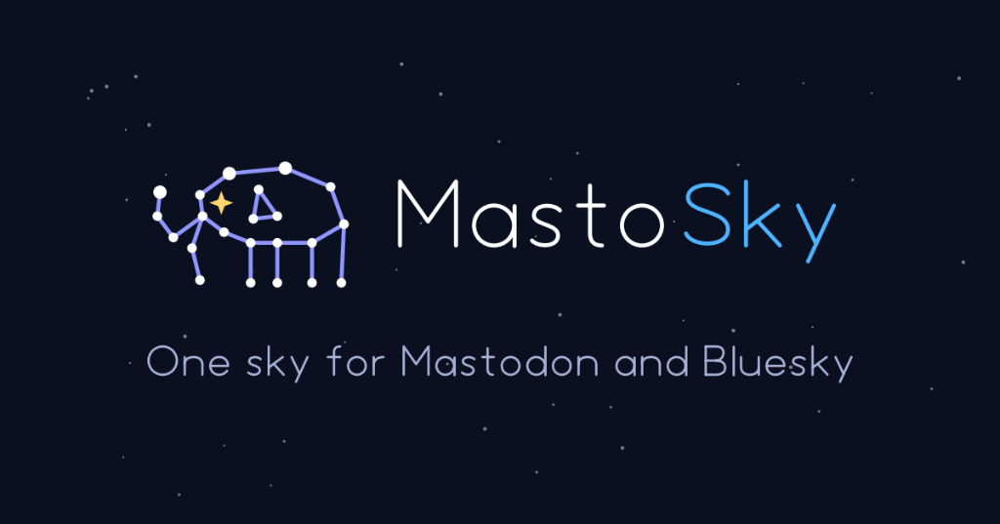

<p align="right">
  <b>English</b> | <a href="README.pt.md">Português</a>
</p>

<p align="center">
  
</p>

# MastoSky

A lightweight, local-first web client for **Bluesky** and **Mastodon**.

MastoSky runs on your own machine or home server and puts both timelines, search, direct messages, bookmarks, and cross-posting into one browser tab — without third-party servers, tracking, or external runtime dependencies.

Project page: **[gjmcosta.github.io/MastoSky](https://gjmcosta.github.io/MastoSky/)**

---

## Features

### Timeline & Reading
- **Unified chronological feed:** View Bluesky and Mastodon posts together, or filter quickly by network and `No boosts`.
- **Cross-post deduplication (Crosstalk):** Simultaneous posts by the same author on Mastodon and Bluesky are automatically merged into a single card with a dual network badge.
- **Boost clustering & keyword muting:** Consecutive boosts from the same person can be grouped cleanly, and muted keywords/hashtags can either collapse behind a warning or hide completely.
- **Reading position sync:** Tracks your last read post across devices (*Resume where you left off*), anchors scroll during background refreshes, and offers a **Catch-Up** digest (`6h` / `12h` / `24h`).
- **In-app Reader View & internal links:** Read linked articles distraction-free inside MastoSky. Clicking Bluesky or Mastodon post URLs, `@mentions`, or `#hashtags` opens them inside MastoSky instead of sending you to external sites.

### Composing & Media
- **Cross-post with dual progress rings:** Publish to Bluesky, Mastodon, or both while watching live 300 / 500 character rings.
- **Automatic hybrid threads:** Posts between 301 and 500 characters automatically split into a numbered thread on Bluesky (`1/2`, `2/2`, …) while publishing as a single post on Mastodon. Supports manual thread splitting, Mastodon visibility levels, post editing, and `@handle` autocomplete/mapping across networks.
- **Images, GIFs & Video:** Drag-and-drop or paste up to 4 images (`Cmd+V` / `Ctrl+V`) with ordering and quick crop presets (`1:1`, `16:9`, `4:5`); search and post animated **GIFs** natively to both Bluesky and Mastodon; upload video up to 50 MB (MP4/WebM/MOV).
- **Drafts, Scheduling & Visual Cards:** Auto-saved local drafts, background post scheduler, link previews, polls, content warnings (CW), and generated visual cross-post cards with quoted posts intact.

### Columns, Collections & Messages
- **Single-column or Deck View:** Switch between a compact single feed and customizable side-by-side columns with drag-and-drop ordering, a side thread panel, and full keyboard shortcuts (`?` for help).
- **Saved Collections:** Bookmark posts and organize them into custom folders/collections, with instant filtering and cross-device sync.
- **Feeds & Lists:** Browse Bluesky custom feeds and Mastodon lists in a dedicated column or inside Explore.
- **Direct Messages:** Unified inbox for Bluesky Chat (`chat.bsky.convo`) and Mastodon direct conversations.
- **Notifications:** Filtered views (*Replies*, *Likes*, *Boosts*, *Follows*), unread badges, scroll-to-mark-read, desktop alerts, and synthesized Web Audio chimes.

### Optional AI & Technical Footprint
- **Optional AI Alt-Text & Translation:** Generate WCAG-oriented image descriptions and translate posts/notifications inline using **Ollama** (100% local), **Google Gemini** (free tier), or any **OpenAI-compatible** API.
- **Zero Runtime Dependencies:** Backend uses Python 3 standard library only (`app.py`); frontend is vanilla HTML/CSS/JS (`index.html`, `app.css`, `app.js`). No `pip install`, no Node.js.
- **Bilingual UI:** Full English and Portuguese interface (`theme`: Auto / Light / Dark).

---

## Quickstart

### Download & Run (No Terminal Required)

Download the ready-to-run package for your system from [GitHub Releases](https://github.com/gjmcosta/MastoSky/releases/latest) — **no terminal or Python installation required**:

- **macOS:** [MastoSky-macOS.zip](https://github.com/gjmcosta/MastoSky/releases/latest/download/MastoSky-macOS.zip) — unzip and open `MastoSky.app`
- **Windows:** [MastoSky-Windows-x64.zip](https://github.com/gjmcosta/MastoSky/releases/latest/download/MastoSky-Windows-x64.zip) — unzip and open `MastoSky.exe`
- **Linux:** [MastoSky-Linux-x64.tar.gz](https://github.com/gjmcosta/MastoSky/releases/latest/download/MastoSky-Linux-x64.tar.gz) — extract and run `./MastoSky`
- **Portable ZIP (requires Python 3):** [MastoSky-portable.zip](https://github.com/gjmcosta/MastoSky/releases/latest/download/MastoSky-portable.zip) — unzip and double-click `MastoSky.command` (macOS) or `MastoSky.bat` (Windows)

MastoSky automatically opens `http://127.0.0.1:8000` in your browser. *(On macOS/Windows, the first launch of an unsigned open-source app may ask for one-time confirmation in Gatekeeper / SmartScreen.)*

<details>
<summary><b>Advanced: Terminal, Git, Local Network (--lan) &amp; Docker</b></summary>

#### One-line terminal installer

**macOS / Linux:**
```bash
curl -fsSL https://raw.githubusercontent.com/gjmcosta/MastoSky/main/install.sh | bash
```

**Windows (PowerShell):**
```powershell
irm https://raw.githubusercontent.com/gjmcosta/MastoSky/main/install.ps1 | iex
```

#### Clone and run manually

Requires Python 3.3+.

```bash
git clone https://github.com/gjmcosta/MastoSky.git
cd MastoSky
python3 app.py --open
```

For automatic background startup (`launchd` on macOS or `systemd --user` on Linux), see [docs/README.md](docs/README.md).

#### Mobile & iPad Usage (Local Network & PWA)

To open MastoSky from an iPhone, iPad, or Android device on the same Wi-Fi network:

```bash
python3 app.py --lan
```

- Prints your LAN URL and a scannable **ASCII QR code** directly in the terminal (and a high-resolution QR dialog under the mobile icon in the desktop header).
- **iPhone & iPad (Safari):** Share → *Add to Home Screen* to run full-screen as a standalone PWA with pull-to-refresh and iOS Share Sheet draft support.
- **Android (Chrome):** Menu (`⋮`) → *Install app* or *Add to Home screen*.

#### Docker, CasaOS & Tailscale

MastoSky includes a dependency-free `Dockerfile` (`python:3.12-alpine`) and `docker-compose.yml` with CasaOS metadata:

```bash
docker compose up -d
```

- Stores `config.json`, `user_data.json` (syncing saved posts, collections, drafts, muted words, deck columns, and reading anchor across devices), and `scheduled_posts.json` in `/data` (`MASTOSKY_DATA_DIR`).
- Supports Tailscale CGNAT (`100.64.0.0/10`) and `.ts.net` MagicDNS hosts out of the box (optional `MASTOSKY_TAILSCALE_HOST` / `MASTOSKY_ALLOWED_HOSTS`), plus 1-click persistent self-updates in Settings.

</details>

---

## Account Login

### Bluesky (Direct Sign-In)
- Enter your handle or email and your Bluesky password directly in MastoSky (supports email **2FA**).
- MastoSky automatically generates a dedicated **App Password** via `com.atproto.server.createAppPassword` and stores only that App Password locally — your main password is never saved.
- You can also paste an App Password manually from [bsky.app](https://bsky.app) → **Settings** → **Privacy and Security** → **App Passwords**.

### Mastodon (1-Click OAuth)
- Enter your instance domain (e.g. `mastodon.social`) and click **Sign in with Mastodon** to authorize in one click via OAuth 2.0.
- Manual access tokens remain available under *"Or enter an access token manually"*.

---

## Security & Testing

- **Localhost by default:** Binds strictly to `127.0.0.1`. `--lan` restricts access to RFC 1918 private subnets, `.local` mDNS, Tailscale `100.64.0.0/10` / `.ts.net`, and optional `MASTOSKY_ALLOWED_HOSTS`.
- **Direct API calls:** Requests go straight to official Bluesky XRPC (`didDoc` PDS resolution) and your Mastodon instance. No telemetry or relay servers.
- **CSRF & SSRF protection:** Validates `Host` and `Origin` headers, requires a per-session `X-CSRF-Token` on all mutating endpoints, and validates resolved remote IPs before fetching link previews or Reader articles.
- **Private local state:** `config.json`, `user_data.json`, and `scheduled_posts.json` are written with `0600` permissions and excluded from git.
- **Automated tests:** Run the test suite locally with:
  ```bash
  python3 -m unittest discover -s tests -v
  ```

---

## License

[MIT](LICENSE)
