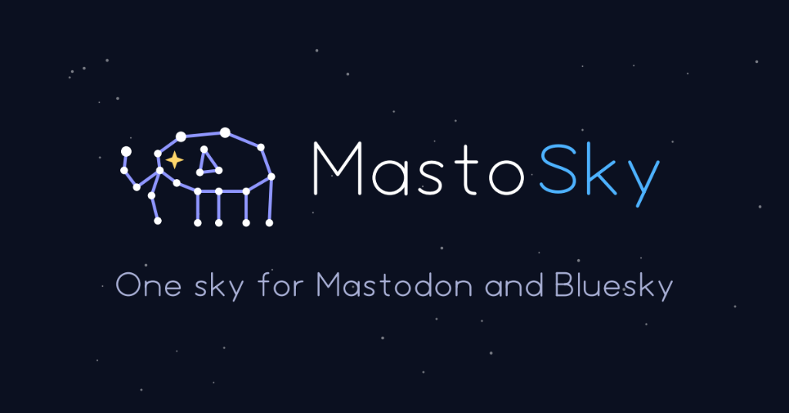

<p align="right">
  <b>English</b> | <a href="README.pt.md">Português</a>
</p>

<p align="center">
  
</p>

# MastoSky

A lightweight, local-first web client for Bluesky and Mastodon.

MastoSky runs locally on your machine and gives you a single tab to read feeds, search, and cross-publish across both networks without third-party servers, tracking, or external runtime dependencies.

---

## Highlights

- **Unified Feeds:** View posts from people you follow on Bluesky and Mastodon merged chronologically, or filter by network.
- **Cross-Posting & Threads:** Compose once and post to Bluesky, Mastodon, or both. Includes thread composition, image pasting (Cmd+V / drag-and-drop), local drafts with auto-save, polls, and content warnings.
- **Unified Search:** Query posts, user profiles, and hashtags across both networks simultaneously.
- **Deck & Single-Column Views:** Switch between a compact single feed and a customizable multi-column layout (Deck View).
- **Notifications & Profiles:** Track likes, reposts, mentions, and inspect profiles side-by-side.
- **AI-Powered Alt-Text:** Automatic, WCAG-compliant image descriptions via Google Gemini (free), Ollama (100% local), or OpenAI-compatible endpoints, with customizable output language.
- **Zero Runtime Dependencies:** Backend uses Python 3 standard library only; frontend is vanilla HTML/CSS/JS. No `pip install`, no Node.js.
- **Privacy & Local-First:** Binds strictly to `127.0.0.1`. Credentials never leave your machine.

---

## Quickstart

### One-line installer

**macOS / Linux:**
```bash
curl -fsSL https://raw.githubusercontent.com/gjmcosta/MastoSky/main/install.sh | bash
```

**Windows (PowerShell):**
```powershell
irm https://raw.githubusercontent.com/gjmcosta/MastoSky/main/install.ps1 | iex
```

### Clone and run manually

Requires Python 3.3+.

```bash
git clone https://github.com/gjmcosta/MastoSky.git
cd MastoSky
python3 app.py --open
```

On first run, open [http://127.0.0.1:8000](http://127.0.0.1:8000) (if it doesn't open automatically) to enter your credentials.

---

## Credentials Setup

### Bluesky
1. Open [bsky.app](https://bsky.app) → **Settings** → **Privacy and Security** → **App Passwords**.
2. Create an app password (e.g. `MastoSky`).
3. Enter your handle (e.g. `user.bsky.social`) and the generated 16-character password in MastoSky.

### Mastodon
1. On your Mastodon instance, go to **Preferences** → **Development** → **New Application**.
2. Name it `MastoSky`. Leave the **Redirect URI** as the default (`urn:ietf:wg:oauth:2.0:oob`).
3. Select only the required scopes: `read:statuses`, `read:notifications`, `write:statuses`, `write:media`, `write:favourites`.
4. Click **Submit**, open the newly created application, and copy **Your access token** (do not copy the *Client key* or *Client secret*).
5. In MastoSky, enter only your instance domain (e.g. `mastodon.social` or `https://mastodon.social` — do not include your username or `@handle`) and paste the access token.

---

## Security

MastoSky is designed to keep your credentials strictly on your computer:

- **Localhost only:** Binds exclusively to `127.0.0.1`. It never listens on public interfaces or your LAN.
- **Direct communication:** Requests go straight from your machine to official Bluesky XRPC and Mastodon instance endpoints. No intermediate servers or analytics.
- **CSRF & Origin protection:** Validates `Host` and `Origin` headers, and requires a per-session cryptographic token (`X-CSRF-Token`) on all mutating endpoints.
- **Local storage:** Credentials are stored in `config.json` (mode `0600`), strictly ignored by git.

---

## License

[MIT](LICENSE)
