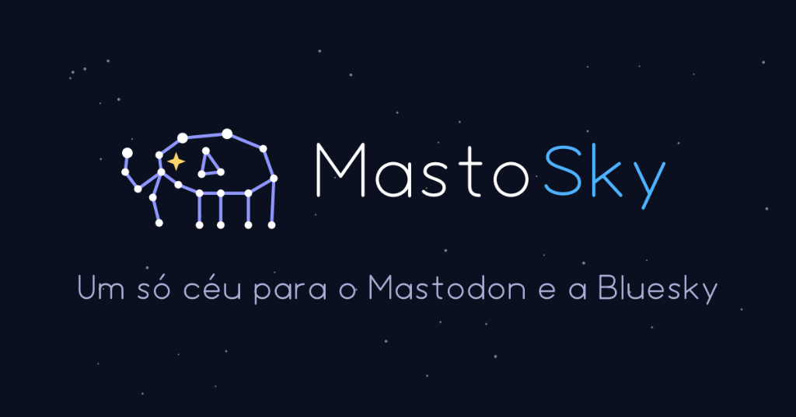

<p align="right">
  <a href="README.md">English</a> | <b>Português</b>
</p>

<p align="center">
  
</p>

# MastoSky

Cliente web leve e *local-first* para **Bluesky** e **Mastodon**.

O MastoSky corre no teu computador ou servidor doméstico e junta feeds, pesquisa, mensagens diretas, guardados e publicação cruzada num único separador do browser — sem servidores intermédios, sem telemetria e sem dependências externas.

Página do projeto: **[gjmcosta.github.io/MastoSky](https://gjmcosta.github.io/MastoSky/)**

---

## Funcionalidades

### Timeline e Leitura
- **Feed cronológico unificado:** Vê publicações do Bluesky e do Mastodon juntas por ordem cronológica, ou filtra rapidamente por rede e `Sem boosts`.
- **Desduplicação de cross-posts (Crosstalk):** Publicações simultâneas do mesmo autor em ambas as redes são fundidas automaticamente num único cartão com indicador duplo.
- **Agrupamento de boosts e silenciamento:** Boosts consecutivos da mesma pessoa podem ser agrupados na timeline, e palavras-chave ou hashtags silenciadas podem surgir com aviso colapsável ou ser ocultadas.
- **Sincronização da posição de leitura:** Guarda o ponto onde paraste entre dispositivos (*Retomar onde ficaste*), fixa o scroll durante atualizações em segundo plano e inclui um resumo rápido *O que perdi?* (`6h` / `12h` / `24h`).
- **Modo de Leitura e ligações internas:** Lê artigos ligados sem distrações diretamente no MastoSky. Ligações para publicações do Bluesky ou Mastodon, `@menções` e `#hashtags` abrem dentro da app em vez de te enviarem para fora.

### Composição e Media
- **Publicação cruzada com anéis duplos:** Escreve uma vez para Bluesky, Mastodon ou ambos, acompanhando em tempo real os limites de 300 e 500 caracteres.
- **Fios híbridos automáticos:** Textos entre 301 e 500 caracteres transformam-se automaticamente num fio numerado no Bluesky (`1/2`, `2/2`, …) mantendo-se como publicação única no Mastodon. Suporta divisão manual em fio, visibilidade no Mastodon, edição de publicações e autocomplete/mapeamento de `@handles` entre redes.
- **Imagens, GIFs e Vídeo:** Cola ou arrasta até 4 imagens (`Cmd+V` / `Ctrl+V`) com reordenação e recorte rápido (`1:1`, `16:9`, `4:5`); pesquisa e publica **GIFs animados** nativos em ambas as redes; envia vídeos até 50 MB (MP4/WebM/MOV).
- **Rascunhos, Agendamento e Cartões Visuais:** Rascunhos locais com gravação automática, agendamento de publicações em segundo plano, pré-visualização de ligações, sondagens, avisos de conteúdo (CW) e cartões visuais para partilha entre redes com citações preservadas.

### Colunas, Coleções e Mensagens
- **Coluna única ou Vista em Deck:** Alterna entre uma lista focada e colunas lado a lado personalizáveis (arrastar para reordenar, coluna lateral de conversas e atalhos de teclado — tecla `?` para ajuda).
- **Coleções nos Guardados:** Guarda publicações em coleções personalizadas, filtra por pasta e sincroniza entre computador, iPad e telemóvel.
- **Feeds e Listas:** Acompanha feeds personalizados do Bluesky e listas do Mastodon numa coluna própria ou no Explorar.
- **Mensagens Diretas:** Caixa unificada para o chat do Bluesky (`chat.bsky.convo`) e conversas diretas do Mastodon.
- **Notificações:** Filtros rápidos (*Respostas*, *Gostos*, *Partilhas*, *Seguidores*), contadores de não lidas, marcação automática ao fazer scroll, alertas de desktop e sons sintetizados em Web Audio.

### IA Opcional e Pegada Técnica
- **Alt-Text e Tradução com IA (opcional):** Gera descrições acessíveis (WCAG) para imagens e traduz posts ou notificações inline usando **Ollama** (100% local), **Google Gemini** (camada gratuita) ou qualquer API compatível com **OpenAI**.
- **Zero Dependências em Runtime:** O backend usa apenas a biblioteca padrão do Python 3 (`app.py`); o frontend é HTML, CSS e JS puros (`index.html`, `app.css`, `app.js`). Sem `pip install`, sem Node.js.
- **Interface Bilingue:** Português e Inglês com tema claro, escuro ou automático do sistema.

---

## Instalação e Execução

### Descarregar e Usar (Sem Terminal)

Descarrega a versão pronta a usar para o teu sistema em [GitHub Releases](https://github.com/gjmcosta/MastoSky/releases/latest) — **não precisa de terminal nem de Python instalado**:

- **macOS:** [MastoSky-macOS.zip](https://github.com/gjmcosta/MastoSky/releases/latest/download/MastoSky-macOS.zip) — extrai e abre `MastoSky.app`
- **Windows:** [MastoSky-Windows-x64.zip](https://github.com/gjmcosta/MastoSky/releases/latest/download/MastoSky-Windows-x64.zip) — extrai e abre `MastoSky.exe`
- **Linux:** [MastoSky-Linux-x64.tar.gz](https://github.com/gjmcosta/MastoSky/releases/latest/download/MastoSky-Linux-x64.tar.gz) — extrai e executa `./MastoSky`
- **ZIP Portátil (requer Python 3):** [MastoSky-portable.zip](https://github.com/gjmcosta/MastoSky/releases/latest/download/MastoSky-portable.zip) — extrai e dá duplo clique em `MastoSky.command` (macOS) ou `MastoSky.bat` (Windows)

O MastoSky abre automaticamente `http://127.0.0.1:8000` no teu browser. *(Por ser uma app open-source sem assinatura paga, na primeira abertura o macOS/Windows pode pedir confirmação no Gatekeeper / SmartScreen.)*

<details>
<summary><b>Avançado: Terminal, Git, Rede Local (--lan) e Docker</b></summary>

#### Instalador em comando único

**macOS / Linux:**
```bash
curl -fsSL https://raw.githubusercontent.com/gjmcosta/MastoSky/main/install.sh | bash
```

**Windows (PowerShell):**
```powershell
irm https://raw.githubusercontent.com/gjmcosta/MastoSky/main/install.ps1 | iex
```

#### Instalação manual via Git

Requer apenas Python 3.3+.

```bash
git clone https://github.com/gjmcosta/MastoSky.git
cd MastoSky
python3 app.py --open
```

Para arrancar automaticamente em segundo plano (`launchd` no macOS ou `systemd --user` no Linux), consulta [docs/README.md](docs/README.md).

#### Telemóvel e iPad (Rede Local & PWA)

Para acederes a partir do iPhone, iPad ou Android na mesma rede Wi-Fi:

```bash
python3 app.py --lan
```

- Mostra o endereço local e imprime um **QR Code ASCII** legível pela câmara no terminal (além de uma janela com QR Code de alta definição no cabeçalho da app).
- **iPhone e iPad (Safari):** *Partilhar* → *Adicionar ao Ecrã Principal* para correr em ecrã inteiro como PWA, com *pull-to-refresh* e receção de links partilhados do iOS.
- **Android (Chrome):** Menu (`⋮`) → *Instalar aplicação* ou *Adicionar ao ecrã principal*.

#### Docker, CasaOS e Tailscale

Inclui `Dockerfile` sem dependências (`python:3.12-alpine`) e `docker-compose.yml` pronto para **CasaOS**:

```bash
docker compose up -d
```

- Guarda `config.json`, `user_data.json` (sincronização automática de guardados, coleções, rascunhos, palavras silenciadas, colunas do Deck e posição de leitura entre dispositivos) e `scheduled_posts.json` em `/data` (`MASTOSKY_DATA_DIR`).
- Suporta endereços Tailscale CGNAT (`100.64.0.0/10`) e domínios `.ts.net` (MagicDNS), com atualização persistente em 1 clique nas Definições.

</details>

---

## Iniciar Sessão nas Contas

### Bluesky (Login Direto)
- Introduz o teu handle ou e-mail e a tua palavra-passe do Bluesky diretamente no MastoSky (com suporte a **2FA** por e-mail).
- O MastoSky cria automaticamente uma **App Password** dedicada via `com.atproto.server.createAppPassword` e guarda apenas essa App Password localmente — a tua palavra-passe principal nunca é guardada.
- Se preferires, podes continuar a colar manualmente uma App Password gerada em [bsky.app](https://bsky.app) → **Definições** → **Privacidade e Segurança** → **Palavras-passe da aplicação**.

### Mastodon (OAuth em 1 Clique)
- Indica o domínio da tua instância (ex.: `mastodon.social`) e clica em **Entrar com o Mastodon** para autorizar em 1 clique via OAuth 2.0.
- A introdução manual de token continua disponível na opção recolhida *"Ou introduzir token de acesso manualmente"*.

---

## Segurança e Testes

- **Apenas localhost por omissão:** Escuta estritamente em `127.0.0.1`. O modo `--lan` limita o acesso a redes privadas RFC 1918, mDNS `.local`, Tailscale `100.64.0.0/10` / `.ts.net` e `MASTOSKY_ALLOWED_HOSTS`.
- **Comunicação direta:** Os pedidos seguem diretamente para o protocolo XRPC do Bluesky (com deteção automática de PDS) e para a tua instância Mastodon, sem telemetria nem servidores intermediários.
- **Proteção CSRF e SSRF:** Validação de cabeçalhos `Host` e `Origin`, token `X-CSRF-Token` por sessão em todos os pedidos de escrita e verificação de IPs resolvidos antes de obter pré-visualizações ou artigos no Reader.
- **Dados locais protegidos:** `config.json`, `user_data.json` e `scheduled_posts.json` são guardados localmente com permissões `0600` e ignorados no git.
- **Testes automatizados:** Executa a suite de testes localmente com:
  ```bash
  python3 -m unittest discover -s tests -v
  ```

---

## Licença

[MIT](LICENSE)
