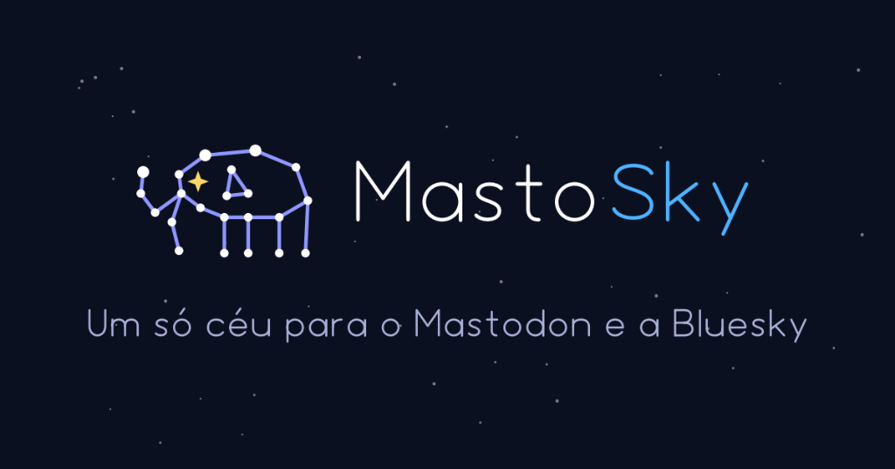

<p align="right">
  <a href="README.md">English</a> | <b>Português</b>
</p>

<p align="center">
  
</p>

# MastoSky

> **Cliente unificado, minimalista e *local-first* para Bluesky e Mastodon.**  
> Uma única interface no teu browser para ler, responder, partilhar e publicar em ambas as redes simultaneamente. Sem dependências externas, sem telemetria, sem intermediários.

---

## ✨ Funcionalidades

* **🔄 Timeline Unificada:** Visualiza os posts das pessoas que segues no Bluesky e no Mastodon misturados cronologicamente numa única página.
* **🗂️ Vista em Colunas (Deck View):** Alterna com 1 clique entre a timeline clássica de coluna única e a visualização em múltiplas colunas (estilo TweetDeck / Mastodon Avançado) com colunas personalizáveis (Compositor, Timeline, Em Alta, Notificações, Perfil) e coluna lateral de detalhes para discussões e perfis.
* **🌍 Interface Bilingue (i18n):** Alternador rápido com 1 clique entre Português e Inglês com persistência de preferências e tradução completa de toda a interface, mensagens e diálogos.
* **🧭 Modos de Navegação Flexíveis:** Escolhe a disposição que preferires: barra lateral flutuante tipo *dock*, cabeçalho fixo no topo (*sticky*) ou disposição estática.
* **🎨 Sistema de Ícones SVG de Marca:** Ícones geométricos minimalistas com indicadores de estado dedicados para visibilidade no Mastodon (Público, Não listado, Seguidores, Direta) e nós coloridos das redes.
* **🔥 Aba "Em Alta":** Descobre o que está a ser mais partilhado e com mais interação em ambas as redes (mesmo de perfis que não segues).
* **🔔 Notificações Centralizadas:** Vê respostas, gostos, partilhas (*boosts* / *reposts*) e citações com contador de novos alertas em tempo real.
* **👤 Perfil e Publicações Próprias:** Visualiza os teus perfis do Bluesky e Mastodon lado a lado com avatares, bios e estatísticas de seguidores, além da timeline dos teus próprios posts com filtros rápidos e opção de apagar.
* **📝 Publicação Cruzada com 1 Clique:** Escreve um post e escolhe se queres publicar apenas no Bluesky, apenas no Mastodon ou em ambos em simultâneo com contagem de caracteres inteligente.
* **💬 Citações Ricas (*Quote Posts*):** Suporte nativo a publicações citadas de ambas as redes, com identificação do autor original, texto e imagens.
* **🎬 Leitor de Vídeo Integrado:** Suporte transparente para streaming adaptativo HLS (`.m3u8` do Bluesky) e ficheiros de vídeo/animações (`.mp4` e `gifv` do Mastodon).
* **🖼️ Suporte a Imagens e Cartões de Links:** Pré-visualização de imagens sem cortes forçados, zoom em tamanho original e cartões de link com domínio.
* **📊 Sondagens:** Cria sondagens com opções personalizadas e duração ajustável (nativas no Mastodon; formatadas como texto claro com opções no Bluesky).
* **⚠️ Avisos de Conteúdo (*Content Warning* / Spoiler):** Marca spoilers ou avisos sensíveis (texto de aviso nativo no Mastodon; prefixo claro `⚠️ [CW: ...]` no Bluesky).
* **🌐 Idioma e Visibilidade:** Etiquetagem de idioma da publicação (`default_lang` no config) e seletor de visibilidade para o Mastodon (Público, Não listado, Apenas seguidores, Direta).
* **🧵 Conversas e Fios:** Explora discussões completas em árvore com o botão de conversa.
* **🌗 Modo Claro e Escuro:** Respeita automaticamente o tema do teu sistema operativo.

---

## 🔒 Filosofia: Zero Dependências & Privacidade Absoluta

* **Zero dependências externas:** Construído apenas com a biblioteca padrão do **Python 3** no servidor e **Vanilla JavaScript / CSS** no cliente. Nada de `pip install`, nem Node.js, nem NPM.
* **100% Local-First:** O servidor corre estritamente em `127.0.0.1` (localhost).
* **Privacidade total:** As tuas credenciais e dados nunca passam por servidores de terceiros ou serviços de recolha de dados; o teu computador comunica diretamente com a API do Bluesky e com a tua instância do Mastodon.

---

## 🚀 Como Executar

### Pré-requisitos
Apenas precisas do **Python 3** instalado (já vem por defeito no macOS e na maioria das distribuições Linux).

### 1. Clonar o repositório
```bash
git clone https://github.com/gjmcosta/MastoSky.git
cd MastoSky
```

### 2. Iniciar a aplicação

Escolhe a forma que preferires para iniciar o MastoSky:

* **🍎 macOS:** Dá duplo clique em **`MastoSky.command`** (inicia o servidor e abre o teu browser automaticamente).
* **🪟 Windows:** Dá duplo clique em **`MastoSky.bat`** (inicia o servidor e abre o teu browser automaticamente).
* **💻 Linha de comandos (qualquer sistema):**
  ```bash
  python3 app.py --open
  ```

#### Opções de Linha de Comandos (CLI)
```text
python3 app.py [-h] [--port PORT] [--open] [--verbose]

Opções:
  --port PORT   Porto HTTP local (substitui o config.json ou o padrão 8000)
  --open        Abre automaticamente o browser predefinido ao iniciar
  --verbose     Regista pedidos HTTP não-sensíveis no terminal (stderr)
```

### 3. Abrir no Browser
Se o browser não abrir automaticamente, acede a:  
👉 **[http://127.0.0.1:8000](http://127.0.0.1:8000)**

Se for a primeira vez que abres a ferramenta, surge automaticamente o **ecrã de configuração** para introduzires as tuas credenciais do Bluesky e/ou do Mastodon.

*(Em alternativa, podes copiar `cp config.example.json config.json` e preencher manualmente antes de iniciar).*

---

## 🔑 Onde obter as credenciais?

### 🦋 Bluesky
1. Vai a [bsky.app](https://bsky.app) e acede a **Definições** (*Settings*) > **Privacidade e Segurança** > **Palavras-passe da aplicação** (*App Passwords*).
2. Cria uma nova palavra-passe com o nome `MastoSky`.
3. Utiliza o teu handle (ex: `oteunome.bsky.social`) e a palavra-passe gerada (formato `xxxx-xxxx-xxxx-xxxx`).
*(Nota: Nunca uses a tua palavra-passe principal da conta; usa sempre uma App Password!)*

### 🐘 Mastodon
1. Acede à tua instância do Mastodon (ex: `https://masto.pt`, `https://mastodon.social`, etc.).
2. Vai a **Preferências** (*Preferences*) > **Desenvolvimento** (*Development*) > **Nova aplicação** (*New Application*).
3. Dá o nome `MastoSky`. **Desmarca** os âmbitos por omissão (`read`, `write`, `follow`, `push`) e marca apenas o mínimo de que o MastoSky precisa: `read:statuses read:notifications write:statuses write:media write:favourites`. Clica em **Guardar**.
4. Clica na aplicação criada e copia o **Token de acesso** (*Your access token*).

---

## 📁 Estrutura do Projeto

```text
MastoSky/
├── MastoSky.command    # Launcher de 1 clique para macOS
├── MastoSky.bat        # Launcher de 1 clique para Windows
├── app.py              # Servidor HTTP local e clientes de API (ATProto / ActivityPub)
├── index.html          # Interface de utilizador completa (HTML, CSS e JavaScript vanilla)
├── brand/              # Identidade visual, tokens e ficheiros SVG (ver brand/BRAND.md)
├── docs/               # Serviços em segundo plano (launchd, systemd) e documentação
├── config.example.json # Modelo de configuração de exemplo
├── CONTRIBUTING.md     # Guia para quem quiser contribuir com código
├── .gitignore          # Bloqueio de segurança para credenciais e ficheiros temporários
├── README.md           # Documentação (Inglês)
├── README.pt.md        # Documentação (Português)
└── LICENSE             # Licença MIT
```

---

## 🔄 Arranque em Segundo Plano

Queres que o MastoSky inicie automaticamente ao ligar o computador? Encontras ficheiros de serviço prontos a usar em [`docs/`](docs/README.md):
* **macOS:** [`docs/launchd/com.mastosky.plist`](docs/launchd/com.mastosky.plist)
* **Linux:** [`docs/systemd/mastosky.service`](docs/systemd/mastosky.service)

---

## 🤝 Contribuir

Contribuições são muito bem-vindas! Consulta o [CONTRIBUTING.md](CONTRIBUTING.md) para conheceres os nossos princípios: zero dependências externas, isolamento estrito em localhost (`127.0.0.1`) e testes unitários obrigatórios.

---

## 🛡️ Segurança & Modelo de Ameaças

O MastoSky foi desenhado com uma arquitetura estrita **local-first e sem telemetria**. Como a premissa central é *"As tuas credenciais não saem da tua máquina"*, o sistema aplica defesa em profundidade em todas as fronteiras de rede e browser:

### 1. Isolamento em Localhost (Fronteira de Rede)
* O servidor HTTP faz bind exclusivamente em `127.0.0.1` (interface de loopback). **Nunca** faz bind em `0.0.0.0` nem em interfaces de rede públicas. Nenhum outro computador ou dispositivo ligado à tua rede Wi-Fi/LAN consegue aceder à tua instância ou porta do MastoSky.

### 2. Proteção Anti-DNS Rebinding e Validação de Host
* Cada pedido valida obrigatoriamente o cabeçalho `Host` contra uma lista estrita autorizada (`127.0.0.1:{PORT}` e `localhost:{PORT}`). Pedidos com nomes de domínio falsificados ou externos (ex.: domínios maliciosos configurados para resolver em `127.0.0.1` através de DNS rebinding) são imediatamente bloqueados com `403 Forbidden`.

### 3. Proteção Cross-Origin & Token CSRF por Sessão
* Ao navegar na Web no mesmo browser, sites maliciosos não conseguem interagir com a tua instância local do MastoSky:
  * **Validação Estrita de Origin:** O servidor bloqueia qualquer pedido que apresente um cabeçalho `Origin` externo (`403 Forbidden`).
  * **Token CSRF por Sessão:** No arranque, o servidor gera um token criptográfico aleatório (`secrets.token_hex(32)`) injetado na interface. Qualquer pedido de alteração de estado (`/api/post`, `/api/action`, `/api/setup`) exige obrigatoriamente este token através do cabeçalho `X-CSRF-Token`.
  * **Same-Origin Policy:** Sites de terceiros não conseguem ler este token devido à política de mesma origem do browser.
  * **Preflight CORS Obrigatório:** A presença do cabeçalho customizado `X-CSRF-Token` força o browser a disparar uma verificação preliminar (`OPTIONS`), bloqueando submissões cegas via `<form>`, `` ou `sendBeacon`.

### 4. Sandboxing de Iframes e Content Security Policy (CSP)
* Todas as respostas HTTP incluem cabeçalhos de segurança rigorosos:
  * `Content-Security-Policy: frame-ancestors 'none'; base-uri 'none'; form-action 'none'` (impede que o MastoSky seja embutido em iframes ou sofra ataques de clickjacking).
  * `X-Frame-Options: DENY`
  * `X-Content-Type-Options: nosniff`
  * `Referrer-Policy: no-referrer`

### 5. Mitigação de SSRF (Server-Side Request Forgery)
* O proxy de imagens local (`/api/proxy_image`) analisa e valida os endereços IP de destino antes de efetuar qualquer pedido, bloqueando estritamente gamas de IP privadas, de loopback ou de rede local (`127.0.0.0/8`, `10.0.0.0/8`, `172.16.0.0/12`, `192.168.0.0/16`).

### 6. Armazenamento de Credenciais
* As tuas credenciais (App Passwords e Access Tokens) são guardadas localmente no ficheiro `config.json` com permissões restritas de sistema de ficheiros (`0600` — legível apenas pela tua conta de utilizador). Nunca são enviadas para servidores de terceiros, analítica ou proxies externos — apenas diretamente para a tua instância Mastodon e para a API oficial do Bluesky. O ficheiro está também protegido no `.gitignore`.

---

## 📄 Licença

Este projeto é de código aberto sob a licença [MIT](LICENSE).

